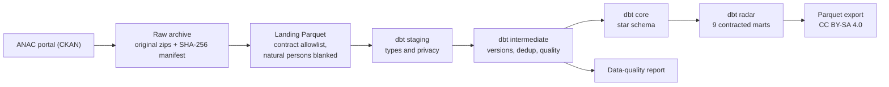
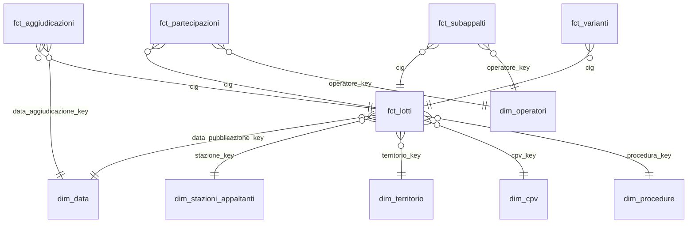

# anac-appalti-dbt

[](https://github.com/HARISPAARTAN/anac-appalti-dbt/actions/workflows/ci.yml)
[](https://harispaartan.github.io/anac-appalti-dbt/)
[](LICENSE)
[](data/LICENSE-DATA.md)

Italiano: [README.md](README.md)

## In short

An analytics-engineering pipeline on the Italian public-procurement open data published by ANAC
(dati.anticorruzione.it). One command downloads only new or changed files from the CKAN portal, keeps them in
an immutable raw archive, converts them to Parquet under a column contract, models them with dbt on DuckDB in a
star schema and builds nine aggregate marts for the Appalti Radar report. Every run leaves a data-quality report
and a run log with timings, row counts and per-model hashes. Dagster orchestrates the same steps as an asset
graph.

> **Status of the numbers.** The full run on real data (2024-2026) has not happened yet. Every number in this
> README comes from the synthetic fixture (data generated by the project, not ANAC data) or is an estimate, and
> says so. The table in the "Data quality" section is filled in by `uv run appalti report` after the first real
> run; `docs/qualita-dati.md` is today the fixture report and is replaced by the real one.

- Scope: lots (CIG) published from 2024 onwards (configurable in `appalti.toml`), with awards, winners,
  bidders, contract modifications, subcontracts, the contracting-authority register and the procedure
  vocabulary.
- Stack: Python 3.13, uv, dbt-core 1.12 with dbt-duckdb, DuckDB, Dagster with dagster-dbt, pytest, ruff,
  GitHub Actions, GitHub Pages.
- dbt docs (models, columns, tests, lineage), generated on the fixture:
  https://harispaartan.github.io/anac-appalti-dbt/dbt/ and the Dagster asset graph:
  https://harispaartan.github.io/anac-appalti-dbt/dagster/ (landing page
  https://harispaartan.github.io/anac-appalti-dbt/).
- Model, table and column names are Italian, dbt prefixes are English; the glossary
  [docs/glossario.md](docs/glossario.md) translates the domain terms into English and German.

## Architecture



1. **Extract** (`ckan.py`, `archivio.py`): reads `package_show` for every package in scope, compares
   `last_modified` and size with the manifest and downloads only new or republished files. Zips stay untouched
   in `data/raw/anac/` with date and SHA-256 in the name; the manifest (`data/raw/_manifest.csv`) is
   append-only. The portal's WAF answers HTTP 200 with an HTML rejection page: the page is detected by its
   content and the client retries once with a browser User-Agent, logging which one worked (the reason is in
   [ADR-003](docs/decisioni/ADR-003-raw-archive.md)). CSV headers are the real ones, read from the portal on
   2026-10-25 with a Range request on the first 128 KB of every zip (`appalti intestazioni`).
2. **Landing** (`landing.py`): DuckDB reads every CSV as text (`all_varchar`) and writes zstd Parquet with only
   the columns marked `tenere: true` in the contract (`contratti/anac/*.yml`). A missing column is an error; a
   new column is a warning and is not landed. **Natural persons are blanked here**: tax code and name of a
   16-character code become NULL before the Parquet exists (see
   [ADR-004](docs/decisioni/ADR-004-privacy.md)). Landed rows are reconciled with the `numero_righe` of ANAC's
   logCsv files.
3. **dbt** (`dbt/`): staging casts types and repeats the natural-person blanking as a second line of defence;
   intermediate keeps the current version of every lot and flags duplicates, impossible dates and amount
   outliers; core builds the star schema; radar exposes the marts with enforced dbt contracts. dbt `sources`
   are generated from the contracts (`appalti contratti sync`) and CI checks that they are in sync.
4. **Orchestration** (`definitions.py`): one raw and one landing asset per package, one asset per dbt model and
   a summary asset with the `qualita_dati` check. A landing or dbt error fails the asset, so the Dagster run
   status is FAILURE too; the `pipeline_completo` job uses the in-process executor. The `ckan_aggiornato`
   sensor polls the portal once a day and the `mensile_25` schedule is the fallback on the 25th of every month:
   both start stopped and are switched on by hand in the daemon. `appalti run` executes the same assets
   in-process, with no services, and exits with code 1 if anything failed.

## Sources and licences

- Data: ANAC open-data portal https://dati.anticorruzione.it/opendata (CKAN API). Packages used: `cig-2024`,
  `cig-2025`, `cig` (monthly deltas), `aggiudicazioni`, `aggiudicatari`, `partecipanti`, `varianti`,
  `subappalti`, `stazioni-appaltanti`, `bandi-cig-tipo-scelta-contraente`, all CC BY-SA 4.0.
- Derived data published by this repository (aggregate marts only, in release assets) is released under the
  same licence with this attribution, kept in Italian:

  > Fonte: ANAC – Autorità Nazionale Anticorruzione, dati.anticorruzione.it, licenza CC BY-SA 4.0; dati elaborati

- Code is MIT ([LICENSE](LICENSE)); data details are in [data/LICENSE-DATA.md](data/LICENSE-DATA.md) and the
  reasoning in [ADR-005](docs/decisioni/ADR-005-licenza-cc-by-sa.md).
- The fixture in `data/fixtures/` is synthetic: it contains no real ANAC records and no personal data. The
  documentation site is generated on it.

## Data model



The dbt project has 40 models (plus 3 seeds):

- **Staging** (`stg_anac__*`, 8 models): one model per source table, explicit types, normalised codes,
  `tipo_soggetto_privacy` for every operator.
- **Intermediate** (`int_*`, 12 models): `int_cig__versioni` keeps every lot version per file;
  `int_cig__corrente` keeps the latest; `int_lotti__qualita` carries the quality flags; `int_perdite_parsing`
  counts the values the typing cannot read; `int_riconciliazione` compares landed rows with ANAC's logCsv
  files.
- **Core** (6 dimensions, 5 facts): every dimension has an `ND` row for missing values. `dim_operatori` holds
  the legal entities (11-digit codes) plus two anonymous members, `PERSONA_FISICA` and `NON_VERIFICABILE`. All
  natural persons of one lot and role are pooled into the `PERSONA_FISICA` row of `fct_partecipazioni`, with no
  identity and no link across files; their number stays in `n_righe_partecipanti` and `n_righe_aggiudicatari`.
- **Radar** (9 marts, enforced dbt contracts, exported to Parquet):

| Mart | Content |
|---|---|
| `mart_appalti_regione_mese` | Lots, total and median amount, PNRR share by region, month and contract type |
| `mart_appalti_settore_cpv` | Lots, amounts and direct-award share by CPV division, sector and year |
| `mart_procedure` | Lots and amounts, with their shares, by procedure family, region and year |
| `mart_tasso_aggiudicazione` | Share of lots awarded among those whose bid deadline passed at least 180 days ago |
| `mart_tempi_aggiudicazione` | Days from publication to award (median and 90th percentile) |
| `mart_concorrenza` | Average bids and share of single-bid lots by CPV division, region and year |
| `mart_ribassi` | Median, 10th and 90th percentile award discount by procedure family and contract type |
| `mart_varianti_subappalti` | Share of lots with a modification, modifications per lot and subcontract share by region and year |
| `mart_stazioni_appaltanti` | Lots, amounts, direct awards and single bids per contracting authority (public bodies) |

## Data quality

The table below holds the measures of the last full run on real data (`uv run appalti run`, then
`uv run appalti report`); until that run exists it holds only a placeholder. Every check, with count and share,
is detailed in [docs/qualita-dati.md](docs/qualita-dati.md) (Italian; today it is the synthetic-fixture report
and says so, and a real `appalti report` replaces it); timings, files and disk per stage are in
[docs/ultima-esecuzione.md](docs/ultima-esecuzione.md), which exists after the first `appalti report`.

<!-- numeri:inizio -->
No full run on real data recorded yet: `uv run appalti report` writes this table.
<!-- numeri:fine -->

Numbers from the synthetic fixture (generated by the project, not ANAC data), as an example of the format:

| Measure (fixture, month 2) | Value |
|---|---:|
| CIG rows landed → current lots | 1,704 → 1,500 |
| Injected defects: exact duplicates · impossible dates · amount outliers | 3 · 3 · 3 |
| dbt models · models with a description and a key test | 40 · 40 |
| dbt tests: severity error · warn · unit tests | 129 · 17 · 25 |
| `dbt build` result (166 tests passed, 5 expected warnings) | 166 pass · 5 warn |

Checks run on every `dbt build`:

- Error severity: unique and not-null keys on every model, referential integrity between facts and dimensions,
  row reconciliation against the logCsv files, no personal tax codes and no personal columns in the marts.
  `appalti copertura-test` checks from the manifest that every model has a description and a key test.
- Warning severity (flag, never delete): exact and conflicting duplicates, impossible dates, amount outliers
  (≤ 0, above the tender total, above 5 billion, beyond 3 MAD on a log scale), awarded lots without a winner,
  orphan awards and authorities, out-of-range discounts.
- Parse losses: amounts and discounts follow a single rule for the decimal separator (a single point is always
  the decimal separator, as in the ANAC format: `12.345` is twelve point three four five; a lone comma followed
  by three digits is ambiguous and such an amount is not guessed). Text the typing cannot read does not become a
  silent NULL: it stays in the `*_raw` column, the lot is excluded from sums and the report counts it. On the
  dates and counts used by the marts, every column has a warning-level dbt test `perdita_parsing` (non-empty
  text that yields NULL) and the `int_perdite_parsing` model feeds the report.

## Quick start

Requirements: Python 3.13 and [uv](https://docs.astral.sh/uv/).

```bash
git clone https://github.com/HARISPAARTAN/anac-appalti-dbt.git
cd anac-appalti-dbt
uv sync
uv run appalti run --fixtures       # full chain offline on the synthetic fixture
uv run appalti report --fixtures    # build/fixture/docs/qualita-dati.md and ultima-esecuzione.md
uv run dagster dev -m anac_appalti.definitions   # asset graph on http://localhost:3000
```

## Full run

```bash
uv run appalti run       # real data from the ANAC portal (2024-2026)
uv run appalti report    # updates docs/ and the numbers table above
uv run appalti export    # nine marts in build/export/*.parquet
```

The figures in this section are estimates from the sizes CKAN reports and from the project spec, not
measurements: the first full run will replace them with measured values (numbers table and
`docs/ultima-esecuzione.md`).

- First-run download: about 2 GB of zips (estimate; CKAN lists about 9 GB of uncompressed CSV). Later monthly
  runs download only the new deltas.
- Disk: extraction stops when free space drops below 30 GB (`spazio_libero_min_gb` in `appalti.toml`); the
  measured size of raw archive, landing and warehouse will be in the numbers table.
- Time: two to three hours for the first run on a home connection (estimate); measured per-stage times will be
  in [docs/ultima-esecuzione.md](docs/ultima-esecuzione.md).
- Warehouse cost: EUR 0 (local DuckDB).
- `APPALTI_HOME` moves `data/`, `build/` and `logs/` to another folder (see `.env.example`).
- If the portal blocks automated downloads, the files can be downloaded in a browser and placed in
  `data/raw/anac/{package}/` under their original names; `uv run appalti run --da-archivio` registers and lands them.
- The WAF may reject automated clients: the pipeline retries once with a browser User-Agent and then fails with
  a clear message (`WafRifiuto`). With a blocked portal every raw asset retries three times at 60-second
  intervals before it reports the error.

## Tests and CI

- `tests/unit`: no network; CKAN parsing, WAF detection, manifest, contracts, tax-code classifier (Python twin
  of the SQL macro, compared in tests), typing macros, report, documents, Dagster definitions (schedule and
  sensor stopped, asset dependencies, the sensor with a stub source).
- `tests/integration`: full pipeline on the fixture, month 1 and month 2 (50 updated lots, one cancellation); a
  second identical run gives the same row counts and the same per-model hashes. Failure paths: a dbt that
  cannot start or a corrupted zip fail the Dagster run, write `esito: errore` in the log and make `appalti run`
  exit with code 1. The `run`, `report`, `export`, `copertura-test` and `docs` commands are exercised with
  typer's runner.
- `ci.yml` (push and pull request, ubuntu-24.04): ruff, dbt sources checked against the contracts, unit tests;
  then the fixture pipeline, data-quality report, key-test coverage, `dagster definitions validate` and
  integration tests.
- `pages.yml` (push to `main`): `dbt docs generate --static` on the fixture, published to GitHub Pages.

## Decisions

- [ADR-001 DuckDB and dbt-core](docs/decisioni/ADR-001-duckdb-dbt.md)
- [ADR-002 Dagster as orchestrator](docs/decisioni/ADR-002-dagster.md)
- [ADR-003 Append-only raw archive, real headers and User-Agent](docs/decisioni/ADR-003-raw-archive.md)
- [ADR-004 Natural-person privacy](docs/decisioni/ADR-004-privacy.md)
- [ADR-005 CC BY-SA 4.0 for derived data](docs/decisioni/ADR-005-licenza-cc-by-sa.md)
- [Glossary: Italian, English, German](docs/glossario.md)

The ADRs are written in Italian.

## Limitations

- Privacy: personal tax codes (16 characters) lose code and name already in the landing zone and are never
  matched across files. Sole traders with an 11-digit VAT number keep their business name, which can contain
  the owner's name: ANAC publishes them as company data and the project treats them the same way. Free-text
  fields are not scanned. The local raw archive keeps the original files (personal data included) and is
  git-ignored.
- ANAC's contract-modification and subcontract files contain no amounts: the marts report counts, not values.
- Geography stops at region (NUTS 2) and province; there is no NUTS 3 mapping.
- The `cig-2026` package does not exist: 2026 lots come from the monthly deltas of the `cig` package.
- The logCsv files of the yearly CIG files list only a total: those files show `non_disponibile` in the
  reconciliation.
- To confirm on the first real file: (a) the `cod_esito = 1` assumption for an award: an award counts as such
  when `cod_esito` is missing or equals 1 (`flag_esito_aggiudicato` in `fct_aggiudicazioni`) and must be checked
  against real values; (b) the single-point decimal rule, verified on sample files but to be checked on the
  whole 2024-2026 range through the parse-loss counts in the report.
- The fixture is synthetic and serves tests and CI; the numbers in this README come from the fixture or are
  declared estimates until a run on real data exists.
- The portal's WAF may reject automated clients; the `--da-archivio` route then applies.

## Roadmap

- Appalti Radar report in Power BI on the exported Parquet marts.
- ANAC's OCDS feed (CC BY 4.0) as a second, EU-comparable source.
- Slim CI on pull requests (`dbt build --select state:modified+ --defer`) and sqlfluff.
- Municipality mapping to NUTS 3.
- MotherDuck as a cloud target: not in v1 (owner's decision), to be considered only if needed.
