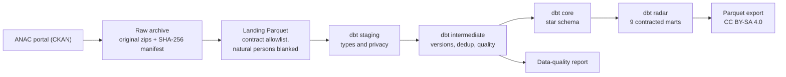
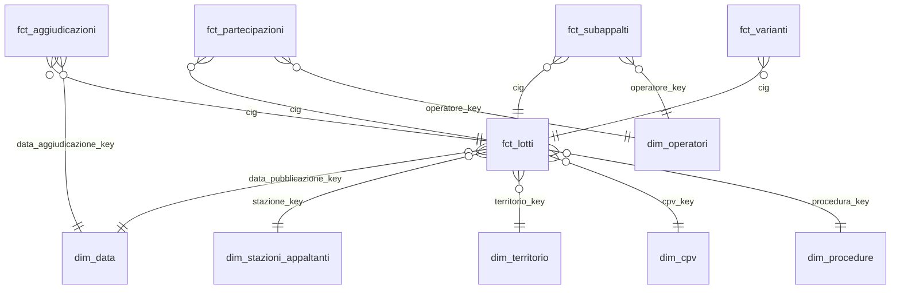

# anac-appalti-dbt

[](https://github.com/HARISPAARTAN/anac-appalti-dbt/actions/workflows/ci.yml)
[](https://harispaartan.github.io/anac-appalti-dbt/)
[](LICENSE)
[](data/LICENSE-DATA.md)

Italiano: [README.md](README.md)

## In short

An analytics-engineering pipeline on the Italian public-procurement open data published by ANAC
(dati.anticorruzione.it). One command downloads only new or changed files from the CKAN portal, keeps them in
an immutable raw archive, converts them to Parquet under a column contract, models them with dbt on DuckDB in a
star schema and builds nine aggregate marts for the Appalti Radar report. Every run leaves a data-quality report
and a run log with timings, row counts and per-model hashes. Dagster orchestrates the same steps as an asset
graph.

> **Status of the numbers.** The numbers in the "Data quality" section were measured in the first full run on real
> ANAC data (2024-2026, run `20261025T125951-e7d029`, 25 October 2026); `docs/qualita-dati.md` is the report of that
> run. The GitHub Pages documentation, on the other hand, is generated by CI on the synthetic fixture, not on the
> real data.

- Scope: lots (CIG) published from 2024 onwards (configurable in `appalti.toml`), with awards, winners,
  bidders, contract modifications, subcontracts, the contracting-authority register and the procedure
  vocabulary.
- Stack: Python 3.13, uv, dbt-core 1.12 with dbt-duckdb, DuckDB, Dagster with dagster-dbt, pytest, ruff,
  GitHub Actions, GitHub Pages.
- dbt docs (models, columns, tests, lineage), generated by CI on the synthetic fixture:
  https://harispaartan.github.io/anac-appalti-dbt/dbt/ and the Dagster asset graph:
  https://harispaartan.github.io/anac-appalti-dbt/dagster/ (landing page
  https://harispaartan.github.io/anac-appalti-dbt/).
- Model, table and column names are Italian, dbt prefixes are English; the glossary
  [docs/glossario.md](docs/glossario.md) translates the domain terms into English and German.

## Architecture



1. **Extract** (`ckan.py`, `archivio.py`): reads `package_show` for every package in scope, compares
   `last_modified` and size with the manifest and downloads only new or republished files. Zips stay untouched
   in `data/raw/anac/` with date and SHA-256 in the name; the manifest (`data/raw/_manifest.csv`) is
   append-only. The portal's WAF answers HTTP 200 with an HTML rejection page: the page is detected by its
   content and the client retries once with a browser User-Agent, logging which one worked (the reason is in
   [ADR-003](docs/decisioni/ADR-003-raw-archive.md)). CSV headers are the real ones, read from the portal on
   2026-10-25 with a Range request on the first 128 KB of every zip (`appalti intestazioni`).
2. **Landing** (`landing.py`): DuckDB reads every CSV as text (`all_varchar`) and writes zstd Parquet with only
   the columns marked `tenere: true` in the contract (`contratti/anac/*.yml`). A missing column is an error; a
   new column is a warning and is not landed. **Natural persons are blanked here**: tax code and name of a
   16-character code become NULL before the Parquet exists (see
   [ADR-004](docs/decisioni/ADR-004-privacy.md)). Landed rows are reconciled with the `numero_righe` of ANAC's
   logCsv files.
3. **dbt** (`dbt/`): staging casts types and repeats the natural-person blanking as a second line of defence;
   intermediate keeps the current version of every lot and flags duplicates, impossible dates and amount
   outliers; core builds the star schema; radar exposes the marts with enforced dbt contracts. dbt `sources`
   are generated from the contracts (`appalti contratti sync`) and CI checks that they are in sync.
4. **Orchestration** (`definitions.py`): one raw and one landing asset per package, one asset per dbt model and
   a summary asset with the `qualita_dati` check. A landing or dbt error fails the asset, so the Dagster run
   status is FAILURE too; the `pipeline_completo` job uses the in-process executor. The `ckan_aggiornato`
   sensor polls the portal once a day and the `mensile_25` schedule is the fallback on the 25th of every month:
   both start stopped and are switched on by hand in the daemon. `appalti run` executes the same assets
   in-process, with no services, and exits with code 1 if anything failed.

## Sources and licences

- Data: ANAC open-data portal https://dati.anticorruzione.it/opendata (CKAN API). Packages used: `cig-2024`,
  `cig-2025`, `cig` (monthly deltas), `aggiudicazioni`, `aggiudicatari`, `partecipanti`, `varianti`,
  `subappalti`, `stazioni-appaltanti`, `bandi-cig-tipo-scelta-contraente`, all CC BY-SA 4.0.
- Derived data published by this repository (aggregate marts only, in release assets) is released under the
  same licence with this attribution, kept in Italian:

  > Fonte: ANAC – Autorità Nazionale Anticorruzione, dati.anticorruzione.it, licenza CC BY-SA 4.0; dati elaborati

- Code is MIT ([LICENSE](LICENSE)); data details are in [data/LICENSE-DATA.md](data/LICENSE-DATA.md) and the
  reasoning in [ADR-005](docs/decisioni/ADR-005-licenza-cc-by-sa.md).
- The fixture in `data/fixtures/` is synthetic: it contains no real ANAC records and no personal data. The
  documentation site is generated on it.

## Data model



The dbt project has 40 models (plus 3 seeds):

- **Staging** (`stg_anac__*`, 8 models): one model per source table, explicit types, normalised codes,
  `tipo_soggetto_privacy` for every operator.
- **Intermediate** (`int_*`, 12 models): `int_cig__versioni` keeps every lot version per file;
  `int_cig__corrente` keeps the latest; `int_lotti__qualita` carries the quality flags; `int_perdite_parsing`
  counts the values the typing cannot read; `int_riconciliazione` compares landed rows with ANAC's logCsv
  files.
- **Core** (6 dimensions, 5 facts): every dimension has an `ND` row for missing values. `dim_operatori` holds
  the legal entities (11-digit codes) plus two anonymous members, `PERSONA_FISICA` and `NON_VERIFICABILE`. All
  natural persons of one lot and role are pooled into the `PERSONA_FISICA` row of `fct_partecipazioni`, with no
  identity and no link across files; their number stays in `n_righe_partecipanti` and `n_righe_aggiudicatari`.
- **Radar** (9 marts, enforced dbt contracts, exported to Parquet):

| Mart | Content |
|---|---|
| `mart_appalti_regione_mese` | Lots, total and median amount, PNRR share by region, month and contract type |
| `mart_appalti_settore_cpv` | Lots, amounts and direct-award share by CPV division, sector and year |
| `mart_procedure` | Lots and amounts, with their shares, by procedure family, region and year |
| `mart_tasso_aggiudicazione` | Share of lots awarded among those whose bid deadline passed at least 180 days ago |
| `mart_tempi_aggiudicazione` | Days from publication to award (median and 90th percentile) |
| `mart_concorrenza` | Average bids and share of single-bid lots by CPV division, region and year |
| `mart_ribassi` | Median, 10th and 90th percentile award discount by procedure family and contract type |
| `mart_varianti_subappalti` | Share of lots with a modification, modifications per lot and subcontract share by region and year |
| `mart_stazioni_appaltanti` | Lots, amounts, direct awards and single bids per contracting authority (public bodies) |

## Data quality

The table below holds the measures of the first full run on real data (`uv run appalti run`, then
`uv run appalti report`). Every check, with count and share, is detailed in
[docs/qualita-dati.md](docs/qualita-dati.md) (Italian); timings, files and disk per stage are in
[docs/ultima-esecuzione.md](docs/ultima-esecuzione.md).

<!-- numeri:inizio -->
| Measure | Value |
|---|---:|
| Current lots (CIG) | 3,734,851 |
| Publication years | 2024–2026 |
| ANAC files downloaded | not available in this run |
| Rows landed | 34,720,158 |
| CIG rows → current lots | 6,334,426 → 3,734,851 |
| Exact duplicates removed | 1,663 (0.03%) |
| dbt models | 40 |
| dbt tests: severity error / warn / unit tests | 129 / 17 / 25 |
| Last dbt build results | pass 164, success 43, warn 7 |
| Models with key tests | 100% |
| Lots with impossible dates | 2,520,462 (67.48%) |
| Lots with amount outliers (excluded from sums) | 150,243 (4.02%) |
| Natural-person rows without identity | 1,631,723 |
| Source freshness | pass 6 |
| Run time: extract · landing · dbt · total | not available in this run · 2 min 57 s · 8 min 43 s · 12 min 7 s |
| Disk: raw · landing · warehouse | 1.94 GB · 1.90 GB · 8.77 GB |
| Warehouse cost | EUR 0 |

| Mart | Rows |
|---|---:|
| `mart_appalti_regione_mese` | 2,152 |
| `mart_appalti_settore_cpv` | 273 |
| `mart_concorrenza` | 2,087 |
| `mart_procedure` | 378 |
| `mart_ribassi` | 57 |
| `mart_stazioni_appaltanti` | 71,987 |
| `mart_tasso_aggiudicazione` | 3,678 |
| `mart_tempi_aggiudicazione` | 3,719 |
| `mart_varianti_subappalti` | 63 |

Reference date 2026-10-25. All numbers come from run `20261025T125951-e7d029`.
<!-- numeri:fine -->

How to read the table: all numbers in the block come from a single run, `20261025T125951-e7d029`, redone from the raw
archive with the corrected code (`--da-archivio`); that is why the download shows "not available in this run". The
download (83 files, 1.94 GB, 6 min 50 s) was measured in the first run (`20261025T121119-3f3dd2`), which stopped in
`dbt build` because of two defects in the real data that were fixed afterwards (see Limitations). Adding up the three
measured stages (6 min 50 s download, 2 min 57 s landing, 8 min 43 s `dbt build`), a complete run from scratch takes
about 18 minutes, not the two to three hours estimated earlier: this is an estimate composed from two runs, not a single
measurement. The synthetic fixture (1,500 lots, injected defects) is now used only for tests and CI.

Checks run on every `dbt build`:

- Error severity: unique and not-null keys on every model, referential integrity between facts and dimensions,
  row reconciliation against the logCsv files, no personal tax codes and no personal columns in the marts.
  `appalti copertura-test` checks from the manifest that every model has a description and a key test.
- Warning severity (flag, never delete): exact and conflicting duplicates, impossible dates, amount outliers
  (≤ 0, above the tender total, above 5 billion, beyond 3 MAD on a log scale), awarded lots without a winner,
  orphan awards and authorities, out-of-range discounts.
- Parse losses: amounts and discounts follow a single rule for the decimal separator (a single point is always
  the decimal separator, as in the ANAC format: `12.345` is twelve point three four five; a lone comma followed
  by three digits is ambiguous and such an amount is not guessed). Text the typing cannot read does not become a
  silent NULL: it stays in the `*_raw` column, the lot is excluded from sums and the report counts it. On the
  dates and counts used by the marts, every column has a warning-level dbt test `perdita_parsing` (non-empty
  text that yields NULL) and the `int_perdite_parsing` model feeds the report.

## Quick start

Requirements: Python 3.13 and [uv](https://docs.astral.sh/uv/).

```bash
git clone https://github.com/HARISPAARTAN/anac-appalti-dbt.git
cd anac-appalti-dbt
uv sync
uv run appalti run --fixtures       # full chain offline on the synthetic fixture
uv run appalti report --fixtures    # build/fixture/docs/qualita-dati.md and ultima-esecuzione.md
uv run dagster dev -m anac_appalti.definitions   # asset graph on http://localhost:3000
```

## Full run

```bash
uv run appalti run       # real data from the ANAC portal (2024-2026)
uv run appalti report    # updates docs/ and the numbers table above
uv run appalti export    # nine marts in build/export/*.parquet
```

Measured in the first real run (25 October 2026, Windows laptop, DuckDB with `memory_limit` 2 GB and 4 threads):

- Download: 83 files and 1.94 GB of zips (estimated 2 GB; CKAN lists about 9 GB of uncompressed CSV), in 6 min
  50 s. Later monthly runs download only the new deltas.
- Disk: raw 1.94 GB, landing 1.90 GB, warehouse 8.77 GB (after the rebuild; 6.85 GB at the first build).
  Extraction stops when free space drops below 30 GB (`spazio_libero_min_gb` in `appalti.toml`).
- Time: landing 2 min 57 s, `dbt build` 8 min 43 s (214 nodes, 171 tests); about 18 minutes from scratch.
- Warehouse cost: EUR 0 (local DuckDB).
- `APPALTI_HOME` moves `data/`, `build/` and `logs/` to another folder (see `.env.example`).
- If the portal blocks automated downloads, the files can be downloaded in a browser and placed in
  `data/raw/anac/{package}/` under their original names; `uv run appalti run --da-archivio` registers and lands them.
- The WAF may reject automated clients: the pipeline retries once with a browser User-Agent and then fails with
  a clear message (`WafRifiuto`). With a blocked portal every raw asset retries three times at 60-second
  intervals before it reports the error.

## Tests and CI

- `tests/unit`: no network; CKAN parsing, WAF detection, manifest, contracts, tax-code classifier (Python twin
  of the SQL macro, compared in tests), typing macros, report, documents, Dagster definitions (schedule and
  sensor stopped, asset dependencies, the sensor with a stub source).
- `tests/integration`: full pipeline on the fixture, month 1 and month 2 (50 updated lots, one cancellation); a
  second identical run gives the same row counts and the same per-model hashes. Failure paths: a dbt that
  cannot start or a corrupted zip fail the Dagster run, write `esito: errore` in the log and make `appalti run`
  exit with code 1. The `run`, `report`, `export`, `copertura-test` and `docs` commands are exercised with
  typer's runner.
- `ci.yml` (push and pull request, ubuntu-24.04): ruff, dbt sources checked against the contracts, unit tests;
  then the fixture pipeline, data-quality report, key-test coverage, `dagster definitions validate` and
  integration tests.
- `pages.yml` (push to `main`): `dbt docs generate --static` on the fixture, published to GitHub Pages.

## Decisions

- [ADR-001 DuckDB and dbt-core](docs/decisioni/ADR-001-duckdb-dbt.md)
- [ADR-002 Dagster as orchestrator](docs/decisioni/ADR-002-dagster.md)
- [ADR-003 Append-only raw archive, real headers and User-Agent](docs/decisioni/ADR-003-raw-archive.md)
- [ADR-004 Natural-person privacy](docs/decisioni/ADR-004-privacy.md)
- [ADR-005 CC BY-SA 4.0 for derived data](docs/decisioni/ADR-005-licenza-cc-by-sa.md)
- [Glossary: Italian, English, German](docs/glossario.md)

The ADRs are written in Italian.

## Limitations

- Privacy: personal tax codes (16 characters) lose code and name already in the landing zone and are never
  matched across files. Sole traders with an 11-digit VAT number keep their business name, which can contain
  the owner's name: ANAC publishes them as company data and the project treats them the same way (a name that
  is a personal tax code is blanked). Free-text fields are not scanned. The local raw archive keeps the original
  files (personal data included) and is git-ignored.
- ANAC's contract-modification and subcontract files contain no amounts: the marts report counts, not values.
- Geography stops at region (NUTS 2) and province; there is no NUTS 3 mapping.
- History: anything before the first local run comes only from ANAC's yearly full files, because superseded
  monthly deltas disappear from the portal; from then on the raw archive keeps them.
- The `cig-2026` package does not exist: 2026 lots come from the monthly deltas of the `cig` package.
- The logCsv files of the yearly CIG files list only a total, so those files have no declared row count. From
  0.1.1 the landing reconciles them against the records counted in the CSV (statuses `ok_fisico` and
  `differenza_fisica`, kept apart from the logCsv statuses `ok` and `differenza`; `righe_attese` then holds the
  counted records, not an ANAC figure). Release 0.1.0 landed them as `non_disponibile`. Measured on 25 October 2026
  on the raw archive with a script independent of the reader: the records outside quoted fields equal the landed
  rows in all 49 files that have a logCsv count and in all 24 yearly files (2,704,490 rows), so no row was lost in
  the yearly files. A plain newline count is wrong in 7 of the 49 files (CIG deltas with newlines inside fields),
  which is why records outside quotes are counted. The count shares the backslash rule with the reader, so it is
  not guaranteed to reveal a lone backslash (next point).
- Backslashes: the reader uses the backslash as escape character, so a lone backslash is dropped silently
  (`A\B` becomes `AB`) and one right before the closing quote swallows the following rows or fails the read. Measured
  on the raw archive (73 files): 2,120 backslashes in total, 1,724 of them not followed by a double quote; all of
  those belong to 863 doubled pairs (`\\`, read as one backslash, which is how ANAC writes a literal backslash),
  and the other 394 escape a quote (`\"`). There is no lone backslash, so the reader drops 0 of them; the behaviour
  is pinned by `tests/unit/test_landing_escape.py`.
- Verified on the first real run (25 October 2026):
  - `cod_esito = 1` is `AGGIUDICATA`: across the 6,035,083 current awards it equals 1 in 99.51% of cases
    (6,005,792); the other codes are 7 and 6 (cancelled or revoked, 0.18% and 0.13%), 99 (not awarded, 0.12%),
    98 (no winner, 0.05%), 90 (tender still open, 0.01%) and 2, 3, 4, 5 (fewer than 60 rows in total). No
    current award has a missing `cod_esito`. The rule stays: awarded when the code is missing or equals 1.
  - Single-point decimal rule: 3,727,125 lot amounts have one point and 7,725 are integers; none has two
    separators. One amount is unreadable (`1E-7`, scientific notation: kept in `*_raw`, excluded from sums) and
    53 awards have an unreadable amount or discount. About 54,000 amounts have more than two decimals (for
    example `427751.27999999997`, floating-point artefacts) and are rounded to `decimal(18,2)`; 17,501 have
    exactly three (`119992.096`), consistent with a decimal point and not with thousands.
  - Parse losses: zero for all seven checked columns (publication, deadline, award, modification and
    subcontract dates, and offer counts).
  - WAF: the portal rejects the project User-Agent (an HTML page with HTTP 200 and a "support ID", detected by
    its body) and the pipeline switches to the browser User-Agent, once per package (8 times); with it every
    download and every Range read (206 required) succeeded, with no other rejection and no retry.
  - Reconciliation: 73 files landed, 49 with row counts equal to the logCsv, 24 `non_disponibile` (the yearly
    `cig-2024` and `cig-2025` files, whose records counted in the CSV all equal the landed rows), no `differenza`.
    No false positive from a stale logCsv on a republished zip: the first run's `differenza` rows were real losses
    (next point).
- Defects found by the first run and fixed in 0.1.0: (1) ANAC files write quotes inside a value with a backslash
  (`\"`), not by doubling them: with a doubled-quote reader one damaged line swallowed the following lines (19 to
  1,335 rows lost in 13 of the 73 files, the deltas from April 2026) and the logCsv reconciliation caught it; the
  landing now uses the backslash as escape and every row matches. (2) Some sole traders have an 11-digit VAT
  number and the owner's personal tax code as business name: the mart test blocked it (65 rows) and that name is
  now blanked at landing and in staging.
- The "impossible dates" check flags 67% of lots, almost all direct awards where the offer deadline precedes
  publication (by 11 days on average): it is an informative warning and excludes no lot from the marts; a rule per
  procedure family is on the roadmap.
- Orphan awards (2.4 million) are expected: the full awards file holds years before 2024. About 1.6% of lots
  (58,733 of 3.73 million) have territory `ND`: unmapped 99x ISTAT codes or none.
- 633 CIG rows have the U+FFFD replacement character in the lot description already in the source file.
- The synthetic-fixture numbers serve tests and CI only; none of them is ANAC data.
- The portal's WAF may reject automated clients even with the browser User-Agent; the `--da-archivio` route then
  applies.

## Roadmap

- Appalti Radar report in Power BI on the exported Parquet marts.
- ANAC's OCDS feed (CC BY 4.0) as a second, EU-comparable source.
- Slim CI on pull requests (`dbt build --select state:modified+ --defer`) and sqlfluff.
- Municipality mapping to NUTS 3.
- Date check per procedure family (today the deadline-before-publication rule fires on direct awards).
- MotherDuck as a cloud target: not in v1 (owner's decision), to be considered only if needed.
