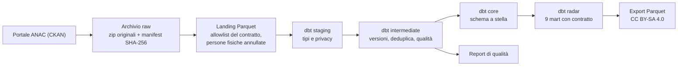
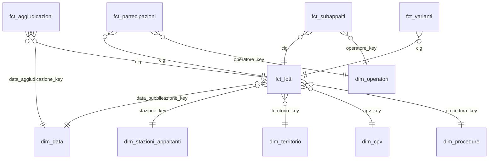

# anac-appalti-dbt

[](https://github.com/HARISPAARTAN/anac-appalti-dbt/actions/workflows/ci.yml)
[](https://harispaartan.github.io/anac-appalti-dbt/)
[](LICENSE)
[](data/LICENSE-DATA.md)

English: [README.en.md](README.en.md)

## In breve

Pipeline di analytics engineering sui dati aperti degli appalti pubblici pubblicati da ANAC
(dati.anticorruzione.it). Un solo comando scarica dal portale CKAN solo i file nuovi o cambiati, li conserva in
un archivio raw immutabile, li converte in Parquet secondo un contratto di colonne, li modella con dbt su DuckDB
in uno schema a stella e produce nove mart aggregati per il report Appalti Radar. Ogni esecuzione lascia un
report di qualità dei dati e un log con tempi, righe e impronte dei modelli. Dagster orchestra gli stessi passi
come grafo di asset.

> **Stato dei numeri.** L'esecuzione completa su dati reali (2024–2026) non è ancora stata fatta. Ogni numero di
> questo README viene dalla fixture sintetica (dati generati dal progetto, non ANAC) oppure è una stima e lo
> dice. La tabella della sezione "Qualità dei dati" viene riempita da `uv run appalti report` dopo la prima
> esecuzione reale; `docs/qualita-dati.md` è oggi il report della fixture e viene sostituito da quello reale.

- Ambito: lotti (CIG) pubblicati dal 2024 in poi (configurabile in `appalti.toml`), con aggiudicazioni,
  aggiudicatari, partecipanti, varianti, subappalti, anagrafe delle stazioni appaltanti e vocabolario delle
  procedure di scelta del contraente.
- Stack: Python 3.13, uv, dbt-core 1.12 con dbt-duckdb, DuckDB, Dagster con dagster-dbt, pytest, ruff,
  GitHub Actions, GitHub Pages.
- Documentazione dbt (modelli, colonne, test, lineage), generata sulla fixture:
  https://harispaartan.github.io/anac-appalti-dbt/dbt/ e grafo degli asset Dagster:
  https://harispaartan.github.io/anac-appalti-dbt/dagster/ (la pagina iniziale è
  https://harispaartan.github.io/anac-appalti-dbt/).
- Nomi di modelli, tabelle e colonne in italiano, prefissi dbt in inglese; il glossario
  [docs/glossario.md](docs/glossario.md) traduce i termini del dominio in inglese e tedesco.

## Architettura



1. **Estrazione** (`ckan.py`, `archivio.py`): legge `package_show` per ogni pacchetto in ambito, confronta
   `last_modified` e dimensione con il manifest e scarica solo i file nuovi o ripubblicati. Gli zip restano
   intatti in `data/raw/anac/` con data e SHA-256 nel nome; il manifest (`data/raw/_manifest.csv`) è
   append-only. Il WAF del portale risponde HTTP 200 con una pagina HTML di rifiuto: la pagina viene
   riconosciuta dal contenuto e il client riprova una volta con un User-Agent da browser, registrando quale
   dei due ha funzionato (il motivo è in [ADR-003](docs/decisioni/ADR-003-raw-archive.md)). Le intestazioni
   dei CSV sono quelle reali, lette dal portale il 2026-10-25 con una richiesta Range sui primi 128 KB di ogni
   zip (`appalti intestazioni`).
2. **Landing** (`landing.py`): DuckDB legge ogni CSV come testo (`all_varchar`) e scrive Parquet zstd con le
   sole colonne marcate `tenere: true` nel contratto (`contratti/anac/*.yml`). Una colonna mancante è un
   errore, una colonna nuova è un avviso e non viene atterrata. **Le persone fisiche sono annullate qui**:
   codice fiscale e denominazione di un codice di 16 caratteri diventano NULL prima che il Parquet esista
   (vedi [ADR-004](docs/decisioni/ADR-004-privacy.md)). Le righe atterrate vengono riconciliate con il
   `numero_righe` dei file logCsv di ANAC.
3. **dbt** (`dbt/`): lo staging tipizza i dati e ripete l'annullamento delle persone fisiche come seconda
   linea di difesa; l'intermediate tiene la versione corrente di ogni lotto e marca duplicati, date
   impossibili e importi anomali; il core costruisce lo schema a stella; il radar espone i mart con il
   contratto dbt applicato. I `sources` dbt sono generati dai contratti (`appalti contratti sync`) e la CI
   verifica che siano allineati.
4. **Orchestrazione** (`definitions.py`): un asset raw e uno di landing per pacchetto, un asset per modello
   dbt, un asset di riepilogo con il controllo `qualita_dati`. Un errore di landing o di dbt fa fallire
   l'asset, quindi anche lo stato dell'esecuzione Dagster; il job `pipeline_completo` usa l'esecutore in
   processo. Il sensor `ckan_aggiornato` interroga il portale una volta al giorno e la schedule `mensile_25` è
   la riserva del 25 di ogni mese: entrambi partono spenti e si accendono a mano nel daemon. `appalti run`
   esegue gli stessi asset in processo, senza servizi, e esce con codice 1 se qualcosa è fallito.

## Fonti e licenze

- Dati: ANAC, portale open data https://dati.anticorruzione.it/opendata (API CKAN). Pacchetti usati:
  `cig-2024`, `cig-2025`, `cig` (delta mensili), `aggiudicazioni`, `aggiudicatari`, `partecipanti`,
  `varianti`, `subappalti`, `stazioni-appaltanti`, `bandi-cig-tipo-scelta-contraente`, tutti con licenza
  CC BY-SA 4.0.
- I dati derivati pubblicati da questo repository (solo i mart aggregati, negli asset delle release) sono
  rilasciati con la stessa licenza e con questa attribuzione:

  > Fonte: ANAC – Autorità Nazionale Anticorruzione, dati.anticorruzione.it, licenza CC BY-SA 4.0; dati elaborati

- Il codice è rilasciato con licenza MIT ([LICENSE](LICENSE)); i dettagli sui dati sono in
  [data/LICENSE-DATA.md](data/LICENSE-DATA.md) e la motivazione in
  [ADR-005](docs/decisioni/ADR-005-licenza-cc-by-sa.md).
- La fixture in `data/fixtures/` è sintetica: non contiene record ANAC reali né dati di persone fisiche.
  Il sito di documentazione è generato su di essa.

## Modello dati



Il progetto dbt ha 40 modelli (più 3 seed):

- **Staging** (`stg_anac__*`, 8 modelli): un modello per tabella sorgente, tipi espliciti, codici normalizzati,
  `tipo_soggetto_privacy` per ogni operatore.
- **Intermediate** (`int_*`, 12 modelli): `int_cig__versioni` conserva ogni versione di lotto per file;
  `int_cig__corrente` tiene la più recente; `int_lotti__qualita` porta i flag di qualità;
  `int_perdite_parsing` conta i valori che la tipizzazione non sa leggere; `int_riconciliazione` confronta le
  righe atterrate con i logCsv di ANAC.
- **Core** (6 dimensioni, 5 fatti): ogni dimensione ha una riga `ND` per i valori mancanti. `dim_operatori`
  contiene le persone giuridiche (codice di 11 cifre) più due membri anonimi, `PERSONA_FISICA` e
  `NON_VERIFICABILE`. Tutte le persone fisiche di un lotto e di un ruolo confluiscono in `fct_partecipazioni`
  nella riga del membro `PERSONA_FISICA`, senza identità e senza collegamento tra file; il loro numero resta in
  `n_righe_partecipanti` e `n_righe_aggiudicatari`.
- **Radar** (9 mart, contratto dbt applicato, esportati in Parquet):

| Mart | Contenuto |
|---|---|
| `mart_appalti_regione_mese` | Lotti, importo totale e mediano, quota PNRR per regione, mese e oggetto del contratto |
| `mart_appalti_settore_cpv` | Lotti, importi e quota di affidamenti diretti per divisione CPV, settore e anno |
| `mart_procedure` | Lotti e importi, con le rispettive quote, per famiglia di procedura, regione e anno |
| `mart_tasso_aggiudicazione` | Quota di lotti aggiudicati tra quelli con offerte scadute da almeno 180 giorni |
| `mart_tempi_aggiudicazione` | Giorni dalla pubblicazione all'aggiudicazione (mediana e 90° percentile) |
| `mart_concorrenza` | Offerte medie e quota di lotti con un'offerta sola per divisione CPV, regione e anno |
| `mart_ribassi` | Ribasso mediano, 10° e 90° percentile per famiglia di procedura e oggetto del contratto |
| `mart_varianti_subappalti` | Quota di lotti con variante, varianti per lotto e quota con subappalto per regione e anno |
| `mart_stazioni_appaltanti` | Lotti, importi, affidamenti diretti e offerta unica per stazione appaltante (enti pubblici) |

## Qualità dei dati

La tabella qui sotto riporta le misure dell'ultima esecuzione completa su dati reali (`uv run appalti run`,
poi `uv run appalti report`); finché quell'esecuzione non c'è, contiene solo un segnaposto. Il dettaglio di
ogni controllo, con conteggio e quota, è in [docs/qualita-dati.md](docs/qualita-dati.md) (oggi è il report
della fixture sintetica e dice di esserlo; un `appalti report` reale lo sostituisce); tempi, file e disco per
fase sono in [docs/ultima-esecuzione.md](docs/ultima-esecuzione.md), che esiste dopo il primo `appalti report`.

<!-- numeri:inizio -->
Nessuna esecuzione completa su dati reali registrata: questa tabella viene scritta da `uv run appalti report`.
<!-- numeri:fine -->

Numeri della fixture sintetica (generati dal progetto, non dati ANAC), a titolo di esempio del formato:

| Misura (fixture, mese 2) | Valore |
|---|---:|
| Righe CIG atterrate → lotti correnti | 1.704 → 1.500 |
| Difetti iniettati: duplicati esatti · date impossibili · importi anomali | 3 · 3 · 3 |
| Modelli dbt · modelli con descrizione e test sulla chiave | 40 · 40 |
| Test dbt: gravità error · warn · unit test | 129 · 17 · 25 |
| Esito di `dbt build` (166 test superati, 5 avvisi attesi) | 166 pass · 5 warn |

Controlli eseguiti a ogni `dbt build`:

- Gravità errore: chiavi uniche e non nulle su ogni modello, integrità referenziale tra fatti e dimensioni,
  riconciliazione delle righe con i logCsv, assenza di codici fiscali personali e di colonne personali nei
  mart. `appalti copertura-test` verifica dal manifest che ogni modello abbia descrizione e test sulla chiave.
- Gravità avviso (si segnala, non si cancella): duplicati esatti e in conflitto, date impossibili, importi
  anomali (≤ 0, oltre il totale di gara, oltre 5 miliardi, oltre 3 MAD su scala logaritmica), lotti
  aggiudicati senza aggiudicatario, aggiudicazioni e stazioni orfane, ribassi fuori intervallo.
- Perdite di lettura: gli importi e i ribassi hanno una regola unica sul separatore decimale (un solo punto è
  sempre il separatore decimale, come nel formato ANAC: `12.345` vale dodici virgola trecentoquarantacinque;
  la sola virgola seguita da tre cifre è ambigua e un importo così non viene indovinato). Un testo che la
  tipizzazione non legge non diventa un NULL silenzioso: resta nella colonna `*_raw`, il lotto è escluso dalle
  somme e il report lo conta. Su date e conteggi usati dai mart, ogni colonna ha un test dbt `perdita_parsing`
  di livello avviso (testo non vuoto che dà NULL) e il modello `int_perdite_parsing` alimenta il report.

## Avvio rapido

Requisiti: Python 3.13 e [uv](https://docs.astral.sh/uv/).

```bash
git clone https://github.com/HARISPAARTAN/anac-appalti-dbt.git
cd anac-appalti-dbt
uv sync
uv run appalti run --fixtures       # catena completa offline sulla fixture sintetica
uv run appalti report --fixtures    # build/fixture/docs/qualita-dati.md e ultima-esecuzione.md
uv run dagster dev -m anac_appalti.definitions   # grafo degli asset su http://localhost:3000
```

## Esecuzione completa

```bash
uv run appalti run       # dati reali dal portale ANAC (2024–2026)
uv run appalti report    # aggiorna docs/ e la tabella dei numeri qui sopra
uv run appalti export    # nove mart in build/export/*.parquet
```

Le cifre di questa sezione sono stime dalle dimensioni dichiarate da CKAN e dalle specifiche del progetto, non
misure: la prima esecuzione completa le sostituirà con i valori misurati (tabella dei numeri e
`docs/ultima-esecuzione.md`).

- Download della prima esecuzione: circa 2 GB di zip (stima; CKAN dichiara circa 9 GB di CSV non compressi).
  Le esecuzioni mensili successive scaricano solo i delta nuovi.
- Disco: l'estrazione si ferma se lo spazio libero scende sotto 30 GB (`spazio_libero_min_gb` in
  `appalti.toml`); l'occupazione misurata di archivio raw, landing e warehouse sarà nella tabella dei numeri.
- Tempo: due o tre ore per la prima esecuzione su una connessione domestica (stima); i tempi misurati per fase
  saranno in [docs/ultima-esecuzione.md](docs/ultima-esecuzione.md).
- Costo del warehouse: 0 EUR (DuckDB locale).
- `APPALTI_HOME` sposta `data/`, `build/` e `logs/` in un'altra cartella (vedi `.env.example`).
- Se il portale blocca i download automatici, i file si possono scaricare dal browser e mettere in
  `data/raw/anac/{pacchetto}/` con il nome originale; `uv run appalti run --da-archivio` li registra e li atterra.
- Il WAF può rifiutare i client automatici: la pipeline riprova una volta con un User-Agent da browser e poi
  fallisce con un messaggio chiaro (`WafRifiuto`). Con un portale bloccato ogni asset raw ritenta tre volte a
  intervalli di 60 secondi prima di riportare l'errore.

## Test e CI

- `tests/unit`: senza rete; parsing CKAN, riconoscimento del WAF, manifest, contratti, classificatore dei
  codici fiscali (gemello Python della macro SQL, confrontati nei test), macro di tipizzazione, report,
  documenti, definizioni Dagster (schedule e sensor spenti, dipendenze degli asset, sensor con una fonte
  finta).
- `tests/integration`: pipeline completa sulla fixture, mese 1 e mese 2 (50 lotti aggiornati, un
  annullamento); una seconda esecuzione identica produce gli stessi conteggi e le stesse impronte per modello.
  Percorsi di fallimento: un dbt che non parte o uno zip corrotto fanno fallire l'esecuzione Dagster, scrivono
  `esito: errore` nel log e fanno uscire `appalti run` con codice 1. Comandi `run`, `report`, `export`,
  `copertura-test` e `docs` provati con il runner di typer.
- `ci.yml` (push e pull request, ubuntu-24.04): ruff, verifica dei sources dbt rispetto ai contratti, unit test;
  poi pipeline sulla fixture, report di qualità, copertura dei test sulle chiavi, `dagster definitions validate`
  e test di integrazione.
- `pages.yml` (push su `main`): `dbt docs generate --static` sulla fixture e pubblicazione su GitHub Pages.

## Decisioni

- [ADR-001 DuckDB e dbt-core](docs/decisioni/ADR-001-duckdb-dbt.md)
- [ADR-002 Dagster come orchestratore](docs/decisioni/ADR-002-dagster.md)
- [ADR-003 Archivio raw append-only, intestazioni reali e User-Agent](docs/decisioni/ADR-003-raw-archive.md)
- [ADR-004 Privacy delle persone fisiche](docs/decisioni/ADR-004-privacy.md)
- [ADR-005 Licenza CC BY-SA 4.0 per i dati derivati](docs/decisioni/ADR-005-licenza-cc-by-sa.md)
- [Glossario italiano, inglese, tedesco](docs/glossario.md)

## Limiti

- Privacy: i codici fiscali personali (16 caratteri) perdono codice e denominazione già nel landing e non si
  collegano tra file. Le ditte individuali con partita IVA di 11 cifre restano con la loro denominazione, che
  può contenere il nome del titolare: ANAC le pubblica come dati d'impresa e il progetto le tratta allo stesso
  modo. I campi di testo libero non sono analizzati. L'archivio raw locale conserva i file originali
  (compresi i dati personali) ed è fuori da git.
- I file ANAC di varianti e subappalti non contengono importi: i mart riportano conteggi, non valori.
- Il territorio arriva a regione (NUTS 2) e provincia; non c'è una mappatura NUTS 3.
- Il pacchetto `cig-2026` non esiste: i lotti 2026 arrivano dai delta mensili del pacchetto `cig`.
- I logCsv dei file annuali CIG riportano solo il totale: quei file risultano `non_disponibile` nella
  riconciliazione.
- Da confermare sul primo file reale: (a) l'assunzione `cod_esito = 1` come aggiudicazione: un'aggiudicazione
  conta come tale se `cod_esito` è assente o vale 1 (`flag_esito_aggiudicato` in `fct_aggiudicazioni`) e va
  verificata sui valori reali; (b) la regola del punto singolo come separatore decimale, verificata sui file di
  esempio ma da riscontrare sull'intero 2024–2026 con il conteggio delle perdite di lettura del report.
- La fixture è sintetica e serve a test e CI; i numeri di questo README vengono dalla fixture o sono stime
  dichiarate, finché non c'è un'esecuzione sui dati reali.
- Il WAF del portale può rifiutare i client automatici; in quel caso vale la procedura `--da-archivio`.

## Roadmap

- Report Appalti Radar in Power BI sui mart esportati in Parquet.
- Feed OCDS di ANAC (CC BY 4.0) come seconda sorgente, confrontabile a livello europeo.
- Slim CI sulle pull request (`dbt build --select state:modified+ --defer`) e sqlfluff.
- Mappatura dei comuni su NUTS 3.
- MotherDuck come target cloud: non è nella v1 (decisione del proprietario), da valutare solo se serve.
