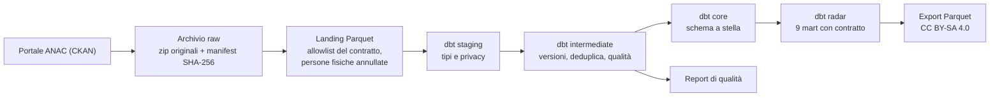
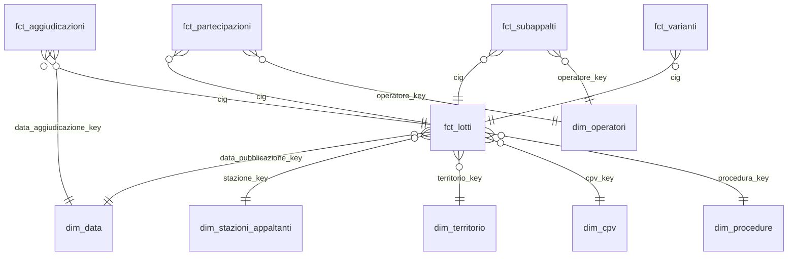

# anac-appalti-dbt

[](https://github.com/HARISPAARTAN/anac-appalti-dbt/actions/workflows/ci.yml)
[](https://harispaartan.github.io/anac-appalti-dbt/)
[](LICENSE)
[](data/LICENSE-DATA.md)

English: [README.en.md](README.en.md)

## In breve

Pipeline di analytics engineering sui dati aperti degli appalti pubblici pubblicati da ANAC
(dati.anticorruzione.it). Un solo comando scarica dal portale CKAN solo i file nuovi o cambiati, li conserva in
un archivio raw immutabile, li converte in Parquet secondo un contratto di colonne, li modella con dbt su DuckDB
in uno schema a stella e produce nove mart aggregati per il report Appalti Radar. Ogni esecuzione lascia un
report di qualità dei dati e un log con tempi, righe e impronte dei modelli. Dagster orchestra gli stessi passi
come grafo di asset.

> **Stato dei numeri.** I numeri della sezione "Qualità dei dati" sono misurati nella prima esecuzione completa
> su dati reali ANAC (2024–2026, run `20261025T125951-e7d029`, 25 ottobre 2026); `docs/qualita-dati.md` è il report
> di quella esecuzione. Le pagine di documentazione su GitHub Pages sono invece generate dalla CI sulla fixture
> sintetica, non sui dati reali.

- Ambito: lotti (CIG) pubblicati dal 2024 in poi (configurabile in `appalti.toml`), con aggiudicazioni,
  aggiudicatari, partecipanti, varianti, subappalti, anagrafe delle stazioni appaltanti e vocabolario delle
  procedure di scelta del contraente.
- Stack: Python 3.13, uv, dbt-core 1.12 con dbt-duckdb, DuckDB, Dagster con dagster-dbt, pytest, ruff,
  GitHub Actions, GitHub Pages.
- Documentazione dbt (modelli, colonne, test, lineage), generata dalla CI sulla fixture sintetica:
  https://harispaartan.github.io/anac-appalti-dbt/dbt/ e grafo degli asset Dagster:
  https://harispaartan.github.io/anac-appalti-dbt/dagster/ (la pagina iniziale è
  https://harispaartan.github.io/anac-appalti-dbt/).
- Nomi di modelli, tabelle e colonne in italiano, prefissi dbt in inglese; il glossario
  [docs/glossario.md](docs/glossario.md) traduce i termini del dominio in inglese e tedesco.

## Architettura



1. **Estrazione** (`ckan.py`, `archivio.py`): legge `package_show` per ogni pacchetto in ambito, confronta
   `last_modified` e dimensione con il manifest e scarica solo i file nuovi o ripubblicati. Gli zip restano
   intatti in `data/raw/anac/` con data e SHA-256 nel nome; il manifest (`data/raw/_manifest.csv`) è
   append-only. Il WAF del portale risponde HTTP 200 con una pagina HTML di rifiuto: la pagina viene
   riconosciuta dal contenuto e il client riprova una volta con un User-Agent da browser, registrando quale
   dei due ha funzionato (il motivo è in [ADR-003](docs/decisioni/ADR-003-raw-archive.md)). Le intestazioni
   dei CSV sono quelle reali, lette dal portale il 2026-10-25 con una richiesta Range sui primi 128 KB di ogni
   zip (`appalti intestazioni`).
2. **Landing** (`landing.py`): DuckDB legge ogni CSV come testo (`all_varchar`) e scrive Parquet zstd con le
   sole colonne marcate `tenere: true` nel contratto (`contratti/anac/*.yml`). Una colonna mancante è un
   errore, una colonna nuova è un avviso e non viene atterrata. **Le persone fisiche sono annullate qui**:
   codice fiscale e denominazione di un codice di 16 caratteri diventano NULL prima che il Parquet esista
   (vedi [ADR-004](docs/decisioni/ADR-004-privacy.md)). Le righe atterrate vengono riconciliate con il
   `numero_righe` dei file logCsv di ANAC.
3. **dbt** (`dbt/`): lo staging tipizza i dati e ripete l'annullamento delle persone fisiche come seconda
   linea di difesa; l'intermediate tiene la versione corrente di ogni lotto e marca duplicati, date
   impossibili e importi anomali; il core costruisce lo schema a stella; il radar espone i mart con il
   contratto dbt applicato. I `sources` dbt sono generati dai contratti (`appalti contratti sync`) e la CI
   verifica che siano allineati.
4. **Orchestrazione** (`definitions.py`): un asset raw e uno di landing per pacchetto, un asset per modello
   dbt, un asset di riepilogo con il controllo `qualita_dati`. Un errore di landing o di dbt fa fallire
   l'asset, quindi anche lo stato dell'esecuzione Dagster; il job `pipeline_completo` usa l'esecutore in
   processo. Il sensor `ckan_aggiornato` interroga il portale una volta al giorno e la schedule `mensile_25` è
   la riserva del 25 di ogni mese: entrambi partono spenti e si accendono a mano nel daemon. `appalti run`
   esegue gli stessi asset in processo, senza servizi, ed esce con codice 1 se qualcosa è fallito.

## Fonti e licenze

- Dati: ANAC, portale open data https://dati.anticorruzione.it/opendata (API CKAN). Pacchetti usati:
  `cig-2024`, `cig-2025`, `cig` (delta mensili), `aggiudicazioni`, `aggiudicatari`, `partecipanti`,
  `varianti`, `subappalti`, `stazioni-appaltanti`, `bandi-cig-tipo-scelta-contraente`, tutti con licenza
  CC BY-SA 4.0.
- I dati derivati pubblicati da questo repository (solo i mart aggregati, negli asset delle release) sono
  rilasciati con la stessa licenza e con questa attribuzione:

  > Fonte: ANAC – Autorità Nazionale Anticorruzione, dati.anticorruzione.it, licenza CC BY-SA 4.0; dati elaborati

- Il codice è rilasciato con licenza MIT ([LICENSE](LICENSE)); i dettagli sui dati sono in
  [data/LICENSE-DATA.md](data/LICENSE-DATA.md) e la motivazione in
  [ADR-005](docs/decisioni/ADR-005-licenza-cc-by-sa.md).
- La fixture in `data/fixtures/` è sintetica: non contiene record ANAC reali né dati di persone fisiche.
  Il sito di documentazione è generato su di essa.

## Modello dati



Il progetto dbt ha 40 modelli (più 3 seed):

- **Staging** (`stg_anac__*`, 8 modelli): un modello per tabella sorgente, tipi espliciti, codici normalizzati,
  `tipo_soggetto_privacy` per ogni operatore.
- **Intermediate** (`int_*`, 12 modelli): `int_cig__versioni` conserva ogni versione di lotto per file;
  `int_cig__corrente` tiene la più recente; `int_lotti__qualita` porta i flag di qualità;
  `int_perdite_parsing` conta i valori che la tipizzazione non sa leggere; `int_riconciliazione` confronta le
  righe atterrate con i logCsv di ANAC.
- **Core** (6 dimensioni, 5 fatti): ogni dimensione ha una riga `ND` per i valori mancanti. `dim_operatori`
  contiene le persone giuridiche (codice di 11 cifre) più due membri anonimi, `PERSONA_FISICA` e
  `NON_VERIFICABILE`. Tutte le persone fisiche di un lotto e di un ruolo confluiscono in `fct_partecipazioni`
  nella riga del membro `PERSONA_FISICA`, senza identità e senza collegamento tra file; il loro numero resta in
  `n_righe_partecipanti` e `n_righe_aggiudicatari`.
- **Radar** (9 mart, contratto dbt applicato, esportati in Parquet):

| Mart | Contenuto |
|---|---|
| `mart_appalti_regione_mese` | Lotti, importo totale e mediano, quota PNRR per regione, mese e oggetto del contratto |
| `mart_appalti_settore_cpv` | Lotti, importi e quota di affidamenti diretti per divisione CPV, settore e anno |
| `mart_procedure` | Lotti e importi, con le rispettive quote, per famiglia di procedura, regione e anno |
| `mart_tasso_aggiudicazione` | Quota di lotti aggiudicati tra quelli con offerte scadute da almeno 180 giorni |
| `mart_tempi_aggiudicazione` | Giorni dalla pubblicazione all'aggiudicazione (mediana e 90° percentile) |
| `mart_concorrenza` | Offerte medie e quota di lotti con un'offerta sola per divisione CPV, regione e anno |
| `mart_ribassi` | Ribasso mediano, 10° e 90° percentile per famiglia di procedura e oggetto del contratto |
| `mart_varianti_subappalti` | Quota di lotti con variante, varianti per lotto e quota con subappalto per regione e anno |
| `mart_stazioni_appaltanti` | Lotti, importi, affidamenti diretti e offerta unica per stazione appaltante e anno; le stazioni che sono persone fisiche sono un solo membro anonimo |

## Qualità dei dati

La tabella qui sotto riporta le misure della prima esecuzione completa su dati reali (`uv run appalti run`, poi
`uv run appalti report`). Il dettaglio di ogni controllo, con conteggio e quota, è in
[docs/qualita-dati.md](docs/qualita-dati.md); tempi, file e disco per fase sono in
[docs/ultima-esecuzione.md](docs/ultima-esecuzione.md).

<!-- numeri:inizio -->
| Misura | Valore |
|---|---:|
| Lotti (CIG) correnti | 3.734.851 |
| Anni di pubblicazione | 2024–2026 |
| File ANAC scaricati | non disponibile in questa esecuzione |
| Righe atterrate | 34.720.158 |
| Righe CIG → lotti correnti | 6.334.426 → 3.734.851 |
| Duplicati esatti rimossi | 1.663 (0,03 %) |
| Modelli dbt | 40 |
| Test dbt: gravità error / warn / unit test | 129 / 17 / 25 |
| Esiti dell'ultimo dbt build | pass 164, success 43, warn 7 |
| Modelli con test sulla chiave | 100 % |
| Lotti con date impossibili | 2.520.462 (67,48 %) |
| Lotti con importi anomali (esclusi dalle somme) | 150.243 (4,02 %) |
| Righe di persone fisiche senza identità | 1.631.723 |
| Freschezza delle sorgenti | pass 6 |
| Durata: estrazione · landing · dbt · totale | non disponibile in questa esecuzione · 2 min 57 s · 8 min 43 s · 12 min 7 s |
| Disco: raw · landing · warehouse | 1,94 GB · 1,90 GB · 8,77 GB |
| Costo del warehouse | 0 EUR |

| Mart | Righe |
|---|---:|
| `mart_appalti_regione_mese` | 2.152 |
| `mart_appalti_settore_cpv` | 273 |
| `mart_concorrenza` | 2.087 |
| `mart_procedure` | 378 |
| `mart_ribassi` | 57 |
| `mart_stazioni_appaltanti` | 71.987 |
| `mart_tasso_aggiudicazione` | 3.678 |
| `mart_tempi_aggiudicazione` | 3.719 |
| `mart_varianti_subappalti` | 63 |

Data di riferimento 2026-10-25. Tutti i numeri vengono dall'esecuzione `20261025T125951-e7d029`.
<!-- numeri:fine -->

Come leggere la tabella: tutti i numeri del blocco vengono da una sola esecuzione, `20261025T125951-e7d029`, rifatta
dall'archivio raw con il codice corretto (`--da-archivio`); per questo il download risulta "non disponibile in questa
esecuzione". Il download (83 file, 1,94 GB, 6 min 50 s) è stato misurato nella prima esecuzione
(`20261025T121119-3f3dd2`), che si è fermata in `dbt build` per due difetti dei dati reali poi corretti (vedi Limiti).
Sommando le tre fasi misurate (6 min 50 s di download, 2 min 57 s di landing, 8 min 43 s di `dbt build`) un'esecuzione
completa da zero costa circa 18 minuti, non le due o tre ore stimate prima: è una stima composta da due esecuzioni, non
una misura unica. La fixture sintetica (1.500 lotti, difetti iniettati) resta solo per test e CI.

Controlli eseguiti a ogni `dbt build`:

- Gravità errore: chiavi uniche e non nulle su ogni modello, integrità referenziale tra fatti e dimensioni,
  riconciliazione delle righe con i logCsv, assenza di codici fiscali personali e di colonne personali nei
  mart. `appalti copertura-test` verifica dal manifest che ogni modello abbia descrizione e test sulla chiave.
- Gravità avviso (si segnala, non si cancella): duplicati esatti e in conflitto, date impossibili, importi
  anomali (≤ 0, oltre il totale di gara, oltre 5 miliardi, oltre 3 MAD su scala logaritmica), lotti
  aggiudicati senza aggiudicatario, aggiudicazioni e stazioni orfane, ribassi fuori intervallo.
- Perdite di lettura: gli importi e i ribassi hanno una regola unica sul separatore decimale (un solo punto è
  sempre il separatore decimale, come nel formato ANAC: `12.345` vale dodici virgola trecentoquarantacinque;
  la sola virgola seguita da tre cifre è ambigua e un importo così non viene indovinato). Un testo che la
  tipizzazione non legge non diventa un NULL silenzioso: resta nella colonna `*_raw`, il lotto è escluso dalle
  somme e il report lo conta. Su date e conteggi usati dai mart, ogni colonna ha un test dbt `perdita_parsing`
  di livello avviso (testo non vuoto che dà NULL) e il modello `int_perdite_parsing` alimenta il report.

## Avvio rapido

Requisiti: Python 3.13 e [uv](https://docs.astral.sh/uv/).

```bash
git clone https://github.com/HARISPAARTAN/anac-appalti-dbt.git
cd anac-appalti-dbt
uv sync
uv run appalti run --fixtures       # catena completa offline sulla fixture sintetica
uv run appalti report --fixtures    # build/fixture/docs/qualita-dati.md e ultima-esecuzione.md
uv run dagster dev -m anac_appalti.definitions   # grafo degli asset su http://localhost:3000
```

## Esecuzione completa

```bash
uv run appalti run       # dati reali dal portale ANAC (2024–2026)
uv run appalti report    # aggiorna docs/ e la tabella dei numeri qui sopra
uv run appalti export    # nove mart in build/export/*.parquet
```

Misure della prima esecuzione reale (25 ottobre 2026, portatile Windows, DuckDB con `memory_limit` 2 GB e 4 thread):

- Download: 83 file e 1,94 GB di zip (stimati 2 GB; CKAN dichiara circa 9 GB di CSV non compressi), in 6 min 50 s.
  Le esecuzioni mensili successive scaricano solo i delta nuovi.
- Disco: raw 1,94 GB, landing 1,90 GB, warehouse 8,77 GB (dopo la ricostruzione; 6,85 GB al primo build). L'estrazione
  si ferma se lo spazio libero scende sotto 30 GB (`spazio_libero_min_gb` in `appalti.toml`).
- Tempo: landing 2 min 57 s, `dbt build` 8 min 43 s (214 nodi, 171 test); circa 18 minuti da zero.
- Costo del warehouse: 0 EUR (DuckDB locale).
- `APPALTI_HOME` sposta `data/`, `build/` e `logs/` in un'altra cartella (vedi `.env.example`).
- Se il portale blocca i download automatici, i file si possono scaricare dal browser e mettere in
  `data/raw/anac/{pacchetto}/` con il nome originale; `uv run appalti run --da-archivio` li registra e li atterra.
- Il WAF può rifiutare i client automatici: la pipeline riprova una volta con un User-Agent da browser e poi
  fallisce con un messaggio chiaro (`WafRifiuto`). Con un portale bloccato ogni asset raw ritenta tre volte a
  intervalli di 60 secondi prima di riportare l'errore.

## Test e CI

- `tests/unit`: senza rete; parsing CKAN, riconoscimento del WAF, manifest, contratti, classificatore dei
  codici fiscali (gemello Python della macro SQL, confrontati nei test), macro di tipizzazione, report,
  documenti, definizioni Dagster (schedule e sensor spenti, dipendenze degli asset, sensor con una fonte
  finta).
- `tests/integration`: pipeline completa sulla fixture, mese 1 e mese 2 (50 lotti aggiornati, un
  annullamento); una seconda esecuzione identica produce gli stessi conteggi e le stesse impronte per modello.
  Percorsi di fallimento: un dbt che non parte o uno zip corrotto fanno fallire l'esecuzione Dagster, scrivono
  `esito: errore` nel log e fanno uscire `appalti run` con codice 1. Comandi `run`, `report`, `export`,
  `copertura-test` e `docs` provati con il runner di typer.
- `ci.yml` (push e pull request, ubuntu-24.04): ruff, verifica dei sources dbt rispetto ai contratti, unit test;
  poi pipeline sulla fixture, report di qualità, copertura dei test sulle chiavi, `dagster definitions validate`
  e test di integrazione.
- `pages.yml` (push su `main`): `dbt docs generate --static` sulla fixture e pubblicazione su GitHub Pages.

## Decisioni

- [ADR-001 DuckDB e dbt-core](docs/decisioni/ADR-001-duckdb-dbt.md)
- [ADR-002 Dagster come orchestratore](docs/decisioni/ADR-002-dagster.md)
- [ADR-003 Archivio raw append-only, intestazioni reali e User-Agent](docs/decisioni/ADR-003-raw-archive.md)
- [ADR-004 Privacy delle persone fisiche](docs/decisioni/ADR-004-privacy.md)
- [ADR-005 Licenza CC BY-SA 4.0 per i dati derivati](docs/decisioni/ADR-005-licenza-cc-by-sa.md)
- [Glossario italiano, inglese, tedesco](docs/glossario.md)

## Limiti

- Privacy: i codici fiscali personali (16 caratteri) perdono codice e denominazione già nel landing e non si
  collegano tra file. Le ditte individuali con partita IVA di 11 cifre restano con la loro denominazione, che
  può contenere il nome del titolare: ANAC le pubblica come dati d'impresa e il progetto le tratta allo stesso
  modo (se la denominazione è un codice fiscale personale viene annullata). I campi di testo libero non sono
  analizzati. L'archivio raw locale conserva i file originali (compresi i dati personali) ed è fuori da git.
- I file ANAC di varianti e subappalti non contengono importi: i mart riportano conteggi, non valori.
- Il territorio arriva a regione (NUTS 2) e provincia; non c'è una mappatura NUTS 3.
- Storia: ciò che precede la prima esecuzione locale proviene solo dai file completi annuali di ANAC, perché i
  delta mensili superati scompaiono dal portale; da allora l'archivio raw li conserva.
- Il pacchetto `cig-2026` non esiste: i lotti 2026 arrivano dai delta mensili del pacchetto `cig`.
- I logCsv dei file annuali CIG riportano solo il totale, quindi quei file non hanno un conteggio dichiarato. Dalla
  0.1.1 il landing li riconcilia con i record contati nel CSV (stati `ok_fisico` e `differenza_fisica`, distinti da
  `ok` e `differenza` del logCsv; `righe_attese` contiene allora i record contati, non una cifra di ANAC). La 0.1.0 li
  ha atterrati come `non_disponibile`. Misura del 25 ottobre 2026 sull'archivio raw, con uno script indipendente dal
  lettore: i record fuori dalle virgolette coincidono con le righe atterrate in tutti i 49 file con conteggio nel
  logCsv e nei 24 file annuali (2.704.490 righe), quindi nei file annuali non è andata persa nessuna riga. Il semplice
  conteggio degli a capo sbaglia in 7 dei 49 file (delta CIG con a capo dentro i campi): per questo si contano i
  record fuori dalle virgolette. Il conteggio condivide con il lettore la regola del backslash, quindi non è
  garantito che riveli un backslash isolato (punto seguente).
- Backslash: il lettore usa il backslash come carattere di escape, quindi un backslash isolato viene eliminato in
  silenzio (`A\B` diventa `AB`) e uno subito prima della virgoletta di chiusura fa assorbire le righe seguenti o fa
  fallire la lettura. Misura sull'archivio raw (73 file): 2.120 backslash in tutto, 1.724 dei quali non seguiti da
  una virgoletta; tutti fanno parte di 863 coppie raddoppiate (`\\`, lette come un solo backslash: così ANAC scrive
  un backslash letterale) e gli altri 394 proteggono una virgoletta (`\"`). Nessun backslash è isolato, quindi il
  lettore ne elimina 0; il comportamento è fissato da `tests/unit/test_landing_escape.py`.
- Verificato sulla prima esecuzione reale (25 ottobre 2026):
  - `cod_esito = 1` è `AGGIUDICATA`: sulle 6.035.083 aggiudicazioni correnti vale 1 nel 99,51 % dei casi (6.005.792);
    gli altri codici sono 7 e 6 (annullata o revocata, 0,18 % e 0,13 %), 99 (non aggiudicata, 0,12 %), 98 (nessun
    vincitore, 0,05 %), 90 (gara in corso, 0,01 %) e 2, 3, 4, 5 (meno di 60 righe in tutto). Nessun `cod_esito`
    assente tra le correnti. La regola resta com'è: aggiudicata se il codice manca o vale 1.
  - Regola del punto singolo: 3.727.125 importi di lotto hanno un solo punto e 7.725 sono interi; nessuno ha
    due separatori. Un solo importo non si legge (`1E-7`, notazione scientifica: resta in `*_raw`, escluso dalle
    somme) e 53 aggiudicazioni hanno importo o ribasso illeggibile. Circa 54.000 importi hanno più di due decimali
    (per esempio `427751.27999999997`, artefatti di virgola mobile) e sono arrotondati a `decimal(18,2)`; 17.501
    ne hanno esattamente tre (`119992.096`), coerenti con un punto decimale e non con le migliaia.
  - Perdite di lettura: zero per tutte le sette colonne controllate (date di pubblicazione, scadenza,
    aggiudicazione, variante, subappalto e conteggi di offerte).
  - WAF: lo User-Agent del progetto è rifiutato dal portale (pagina HTML con HTTP 200 e "support ID", riconosciuta
    dal corpo) e la pipeline passa allo User-Agent da browser, una volta per pacchetto (8 volte); con quello tutti i
    download e le letture con Range (che richiedono 206) sono riusciti, senza altri rifiuti e senza ripetizioni.
  - Riconciliazione: 73 file atterrati, 49 con righe uguali al logCsv, 24 `non_disponibile` (i file annuali
    `cig-2024` e `cig-2025`, per i quali i record contati nel CSV coincidono con le righe atterrate), nessuna
    `differenza`. Nessun falso positivo da logCsv non aggiornato per uno zip ripubblicato: le `differenze` della
    prima esecuzione erano perdite vere (punto successivo).
- Difetti trovati dalla prima esecuzione e corretti nella 0.1.0: (1) i file ANAC scrivono le virgolette dentro un valore
  con il backslash (`\"`) e non raddoppiandole: con il lettore a virgolette raddoppiate una riga rovinata assorbiva le
  righe seguenti (da 19 a 1.335 righe perse in 13 dei 73 file, quelli dei delta da aprile 2026) e la riconciliazione dei
  logCsv lo ha segnalato; ora il landing usa il backslash come escape e tutte le righe coincidono. (2) Alcune ditte
  individuali hanno una partita IVA di 11 cifre e come denominazione il codice fiscale personale del titolare: il
  test sui mart lo ha bloccato (65 righe) e ora quella denominazione è annullata al landing e in staging.
- Il controllo "date impossibili" segnala il 67 % dei lotti, quasi tutti affidamenti diretti in cui la data di
  scadenza dell'offerta precede la pubblicazione (in media di 11 giorni): è un avviso informativo e non esclude lotti
  dai mart; una regola per famiglia di procedura è nella roadmap.
- Le aggiudicazioni orfane (2,4 milioni) sono attese: il file completo delle aggiudicazioni contiene anni precedenti
  al 2024. Circa 1,6 % dei lotti (58.733 su 3,73 milioni) ha territorio `ND`: codici ISTAT 99x non mappati o assenti.
- 633 righe CIG contengono il carattere di sostituzione U+FFFD già nel file sorgente.
- I numeri della fixture sintetica servono a test e CI; nulla di quello che è sulla fixture è un dato ANAC.
- Il WAF del portale può rifiutare i client automatici anche con lo User-Agent da browser; in quel caso vale la
  procedura `--da-archivio`.

## Roadmap

- Report Appalti Radar in Power BI sui mart esportati in Parquet.
- Feed OCDS di ANAC (CC BY 4.0) come seconda sorgente, confrontabile a livello europeo.
- Slim CI sulle pull request (`dbt build --select state:modified+ --defer`) e sqlfluff.
- Mappatura dei comuni su NUTS 3.
- Controllo delle date per famiglia di procedura (oggi la scadenza prima della pubblicazione scatta sugli affidamenti diretti).
- MotherDuck come target cloud: non è nella v1 (decisione del proprietario), da valutare solo se serve.
